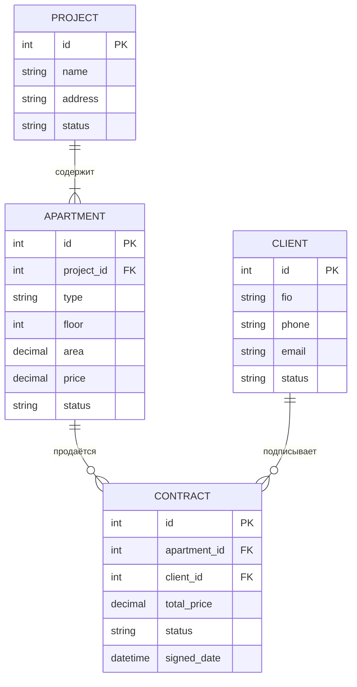

# ERD: Система управления продажами квартир (Brusnika)

### Статусы

| Сущность | Поле | Значения |
|----------|------|----------|
| PROJECT | status | `in_progress`, `completed` |
| APARTMENT | status | `available`, `reserved`, `sold` |
| CONTRACT | status | `draft`, `signed`, `completed` |
| CLIENT | status | `lead`, `prospect`, `client`, `owner` |
